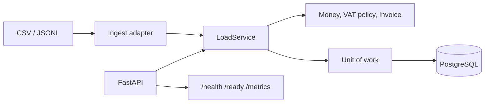

# python-backend-etl-pipeline

Idempotent commercial-invoice ETL. Orders come in as CSV, JSONL, or JSON over HTTP. The service prices each line with `Decimal`, applies a small EU VAT rate card, and upserts the invoice on its natural key `(source_system, external_id)`. Repeating the same HTTP body returns the original result. A different body for the same `Idempotency-Key` is a conflict.

This is a portfolio project for reviewing backend and data-engineering practice: typed boundaries, money that is never a float, a load path you can retry, and tests that do not need Postgres or a network.

## Run the tests

```bash
python -m venv .venv
source .venv/bin/activate
pip install -e ".[dev]"
pytest
```

`pytest` uses an in-memory SQLite database. It does not start Docker, call a tax authority, or read an API key. With Pandas installed (`pip install -e ".[dev,pandas]"`), one extra test checks that the optional reader agrees with the standard-library reader.

## Run the API

```bash
docker compose up --build
```

- API: http://localhost:8000 (`/docs`, `/health`, `/ready`, `/metrics`)
- Postgres: `localhost:5432`, database `etl`, user `etl`, password `etl`

Tables are created on startup from the SQLAlchemy metadata (`create_all` is idempotent). The Compose password is for a local demo. Do not publish that port.

Without Docker, point the process at any SQLAlchemy URL:

```bash
export DATABASE_URL=sqlite+pysqlite:///./etl.db
uvicorn etl_pipeline.api.asgi:app --reload
```

Load the sample file with the same service the API uses:

```bash
etl-pipeline load tests/fixtures/orders_sample.csv --database-url sqlite+pysqlite:///./etl.db
```

The default idempotency key is `file-` plus the SHA-256 of the file bytes. Loading the same file again returns the stored receipt. Pass `--idempotency-key` to name the attempt yourself; a second file under that key exits with code 3.

## A request

Money in JSON is a decimal string. There is no binary float on the money path, including the response.

```bash
curl -s -X POST http://localhost:8000/v1/loads \
  -H 'Content-Type: application/json' \
  -H 'Idempotency-Key: batch-0001' \
  -d '{
    "source_system": "erp-de",
    "orders": [{
      "external_id": "INV-100",
      "ordered_at": "2026-01-15T08:30:00+00:00",
      "currency": "EUR",
      "seller": {"party_id": "SELL-1", "name": "Nordlicht GmbH", "country": "DE", "vat_id": "DE123456789"},
      "buyer": {"party_id": "BUY-1", "name": "Müller AG", "country": "DE", "vat_id": "DE987654321"},
      "lines": [{
        "sku": "SKU-1", "description": "Copper busbar",
        "quantity": "2", "unit_price": "10.50", "vat_category": "standard"
      }]
    }]
  }'
```

`2 * 10.50 = 21.00` net, German standard VAT `21.00 * 0.19 = 3.99`, gross `24.99`. Read it back:

```bash
curl -s http://localhost:8000/v1/invoices/erp-de/INV-100
```

`ordered_at` must carry a timezone offset. A naive timestamp is rejected at the edge (HTTP 422) and, for files, as a row.

Sending the same key and the same body again returns the original JSON and sets `Idempotent-Replayed: true`. Row counters do not move. The same key with a different body is HTTP 409 `IDEMPOTENCY_CONFLICT`. Business failures (bad quantity, unknown VAT category, malformed VAT id) are rows inside a 201: the load succeeded, those orders did not become invoices.

| Method | Path | Role |
| --- | --- | --- |
| `GET` | `/health` | Process is up |
| `GET` | `/ready` | `SELECT 1` against the database. 503 when it is not |
| `GET` | `/metrics` | Prometheus text, in-process |
| `POST` | `/v1/loads` | Requires `Idempotency-Key` |
| `GET` | `/v1/loads/{load_id}` | Stored receipt |
| `GET` | `/v1/invoices/{source_system}/{external_id}` | Invoice, money as strings |
| `GET` | `/v1/invoices` | Header summaries, `limit` 1–200 |

## Architecture

The domain does not import Pandas, SQLAlchemy, FastAPI, or Pydantic. `tests/architecture/test_boundaries.py` parses the source and fails if that changes. Pricing rules are tested without a database. Adapters sit outside the domain and talk to it through plain objects and a unit of work.



| Layer | Package | Allowed to import |
| --- | --- | --- |
| Domain | `etl_pipeline.domain` | Standard library only |
| Application | `etl_pipeline.application` | Domain and its own ports |
| Infrastructure | `etl_pipeline.infrastructure` | Domain, application ports, SQLAlchemy |
| Delivery | `etl_pipeline.api`, `etl_pipeline.cli` | Everything, at the edge |
| Wiring | `etl_pipeline.composition` | Constructs the graph once |

`LoadService` is the only write path. The CLI and `POST /v1/loads` both call it. HTTP idempotency and the natural-key upsert are different mechanisms and both are required:

1. **Idempotency-Key.** The key and a hash of the canonical request are stored in the same transaction as the invoices. A replay returns the stored receipt and does not run the transformer again. Two transactions that insert the same key collide on the primary key; the loser rolls back and reads the winner.
2. **Natural key.** Inside a new request, an invoice whose commercial hash is unchanged is left alone (`unchanged`). A changed hash replaces the header and the lines and increments `version`. The same order submitted under a new key does not create a second invoice.

The commercial hash covers parties, quantities, nets, VAT, and totals. It does not cover `version` or the load id, so a reload of the same document compares equal after a round trip through SQLite or Postgres. Quantities are normalized to 3 decimal places in the hash and money to 2, so a driver that returns `26` and one that returns `26.00` still match.

## Money and VAT

- Amounts are `Decimal`. Constructing `Money` from a `float` raises.
- Unit prices keep up to 4 decimal places. The line net is `ROUND_HALF_UP` to cents, then VAT is `ROUND_HALF_UP` to cents on that net. Invoice VAT is the sum of the line VAT amounts, not a second rounding of the invoice net. `0.025` becomes `0.03`. Banker's rounding would make that `0.02`, which is the wrong surprise on an invoice.
- A line quantity must be `> 0` with at most 3 decimal places. Negative amounts are credit notes and are out of scope, so they are rejections rather than silent sign flips.
- Supported currencies: EUR, RON, USD, GBP, PLN.
- Seller countries on the rate card: AT, DE, ES, FR, GR, IT, NL, PL, RO. Standard, reduced, and (France) super-reduced rates live in `etl_pipeline.domain.vat`.
- Domestic supply uses the seller country's category rate.
- Cross-border EU supply with a structurally valid buyer VAT id is reverse charge (`EU-RC`, rate 0). An invalid id is a rejection. The service does not call VIES and does not invent a rate.
- Cross-border EU supply without a buyer VAT id is charged at the **seller** rate and tagged `b2c_cross_border`. That is not One-Stop-Shop destination VAT.
- A buyer outside the EU is an export at rate 0.
- VAT id checks are prefix and length only, including `EL` for Greece. They are not checksums.

`tests/fixtures/orders_sample.csv` walks the interesting cases in one file: a two-line German invoice (net 26.00, VAT 4.34, gross 30.34), a Romanian reverse charge, a US export, and a negative quantity that is rejected without dropping the other orders.

## Performance

`scripts/bench_transform.py` prices 5,000 two-line orders with no I/O. On the machine used to develop this repo that was about **10,000 orders/second** (5,000 orders in 0.51s). Re-run the script before quoting it. It is a CPU ceiling for the VAT math, not a service SLA. The HTTP path adds parsing, one transaction, and a round trip to Postgres. A request is capped at 1,000 orders (`MAX_ORDERS_PER_REQUEST`, and a hard schema ceiling of 1,000) so a client cannot pin the process with one body. Larger extracts go through the CLI, which still commits them as one transaction and refuses a file above `max_orders` (default 50,000) instead of growing without a bound.

What that choice is protecting:

- **Decimal, on purpose.** Binary floats are faster and wrong. JSON responses use strings (`"24.99"`) so a client does not parse money back into a float either.
- **One query for existing keys, then insert or update.** Unchanged invoices do not rewrite their lines. A changed invoice deletes its lines and inserts the new ones inside the same transaction, so a retry cannot leave a half-updated document. The intermediate flush is there so the unique `(invoice_id, line_no)` constraint does not see the old line and the new line at once.
- **Indexes.** Unique `(source_system, external_id)` on invoices, unique `(invoice_id, line_no)` on lines, plus `ordered_at`, `rejections.load_id`, and `idempotency_keys.load_id`. The idempotency key is the primary key.
- **Pooling.** Postgres uses `pool_pre_ping` and `DB_POOL_SIZE` (default 5). Startup retries `DB_STARTUP_RETRIES` times so the API can wait for Postgres without a manual restart. SQLite, used by the tests, does not take a pool size.
- **The CSV reader is the throughput path.** It streams the file once and groups lines by natural key in memory. The optional Pandas reader (`read_csv_with_pandas`) materializes a DataFrame and then calls the same row parser, which is convenient for a messy analyst extract and the wrong default for a large file. Pandas is not imported unless that function is called, and it is not a dependency of the domain.
- **The rate card is a dict in the process.** There is no per-line tax query.
- **Metrics are fixed-size.** Counters and histogram buckets (plus sum and count) stay bounded. They reset when the process restarts. Scrape `/metrics` from a single replica with that in mind; this is not a clustered aggregator.
- **Replays are cheap.** The stored receipt is returned before the transformer runs, and accepted/rejected counters are not incremented again.

## Security notes, including the limits

- The API has **no authentication**. In a real network it belongs behind a gateway or mTLS, not on a public port. The demo Postgres password is in Compose for the same reason: it is local only.
- SQL is parameterized through SQLAlchemy. Load bodies are not concatenated into statements.
- Logs record load ids and counts. They do not record order payloads.
- `Idempotency-Key` is caller-supplied, 8–200 characters, restricted to a token alphabet. The stored hash is the canonical parsed body (timezone normalized to UTC, countries uppercased), so key order in the JSON does not matter. A client that retries the same logical document with a different decimal scale (`"10.50"` versus `"10.5"`) is a different request. Retries of the identical body match.
- Field lengths are bounded (descriptions, names, SKUs, batch size). CSV grouping fails closed at `max_orders`.
- The container runs as uid 10001 and only exposes port 8000.
- VAT ids are not checked with VIES. A well-formed id can still be unregistered. Destination VAT, fiscal numbering, and credit notes are intentionally absent.

## Layout

```
src/etl_pipeline/
  domain/            money, VAT policy, invoices, ports
  application/       transformer and LoadService
  infrastructure/    CSV/JSONL, SQLAlchemy, metrics, clock
  api/               FastAPI adapters
  cli.py             file loader
  composition.py     wiring
tests/               domain, ingest, service, API, CLI, architecture
tests/fixtures/      sample CSV and JSONL
scripts/bench_transform.py
```

## Author

Alexandru Cojocari. Portfolio project for Python backend and ETL review.

LinkedIn: https://www.linkedin.com/in/alexdataanalyst
